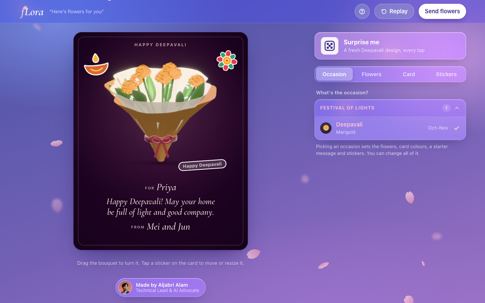
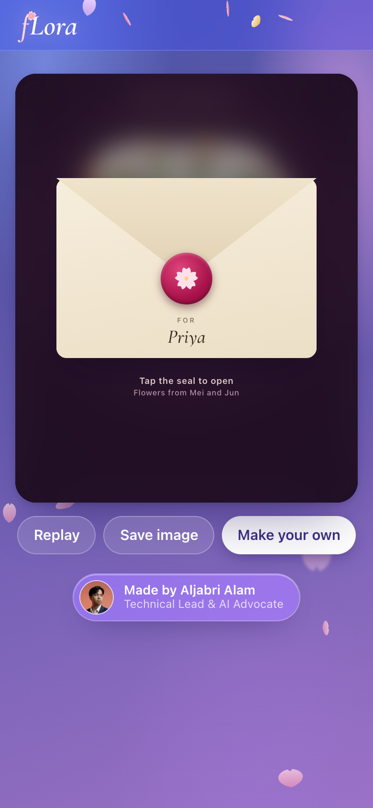
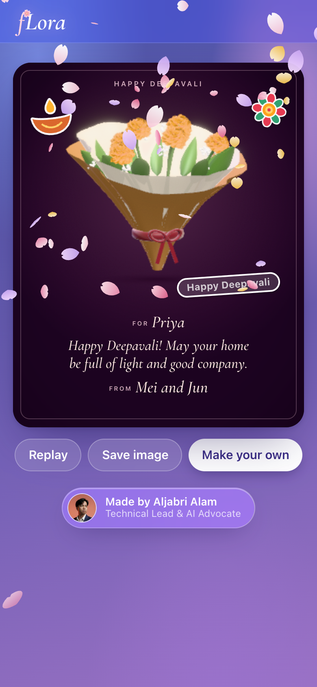
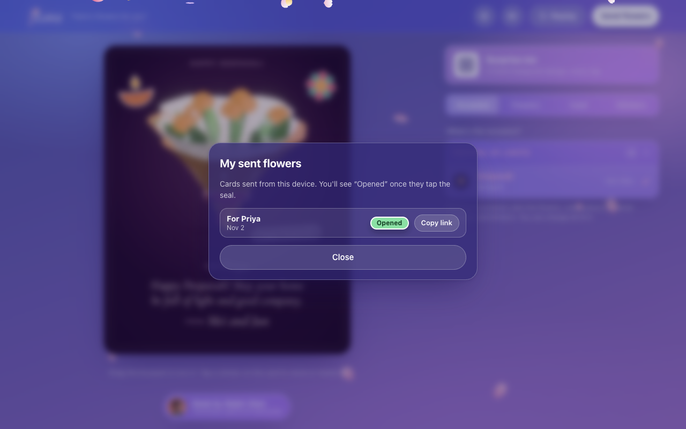
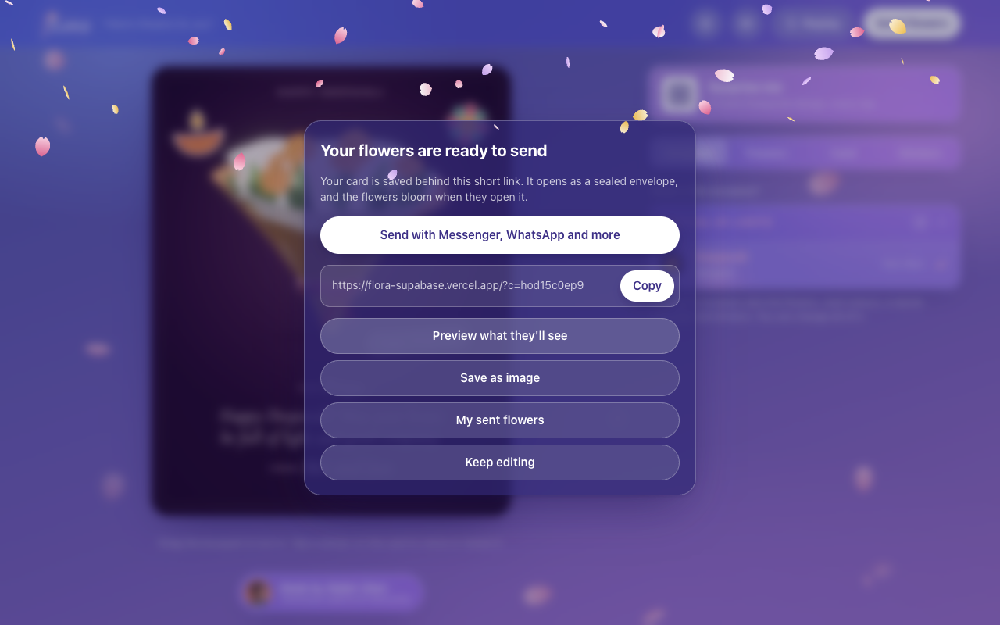

# fLora · Deepavali edition

Send Deepavali flowers that bloom. Build a 3D marigold bouquet, write a card (with a little help from Claude), add a photo, and send it as one short link. The recipient opens a sealed envelope and the bouquet blooms on their screen.

Made by [Aljabri Alam](https://www.linkedin.com/in/aljabri-alam/).

**Live:** https://flora-supabase.vercel.app

| They get a sealed envelope | The flowers bloom | You see it was opened |
|---|---|---|
|  |  |  |

## How we use Supabase

Supabase is the whole backend. There is no custom server for cards: the browser talks to Supabase directly with the public **anon** key, and Postgres row level security plus `security definer` functions decide what that key can do.

| Feature | What happens in Supabase | Client call |
|---|---|---|
| **Short links** | "Send flowers" inserts a row into `public.cards` with a 10-character random id (base32 from `crypto.getRandomValues`). The link is just `/?c=<id>`. | `supabase.from('cards').insert({ id, data, photo_path, reply_to })` |
| **Open a card** | The recipient reads exactly one card by id through `get_card`. The table itself can't be listed or read. | `supabase.rpc('get_card', { p_id })` |
| **Photo** | One photo is shrunk in the browser (max 1600px JPEG, quality 0.8, under 1.5 MB) and uploaded to the public `card-photos` bucket at `<id>/<random>.jpg`. It shows as a polaroid after the bloom. | `supabase.storage.from('card-photos').upload(path, blob)` then `getPublicUrl(path)` |
| **Opened receipt** | Tapping the seal calls `mark_opened`, which sets `opened_at` only once. | `supabase.rpc('mark_opened', { p_id })` |
| **My sent flowers** | Card ids sent from this device live in `localStorage`; `card_status` returns only their opened times (max 20). | `supabase.rpc('card_status', { p_ids })` |
| **Send flowers back** | "Make your own" pre-fills To with the sender's name and stores `reply_to` = the original card id (a foreign key). | part of the insert |

**Security model**

- Row level security is on. `anon` may only **insert** cards (under 20 KB of data); there is no select, update or delete policy, so nobody can browse other people's cards.
- Reading, marking opened and checking status go through three `security definer` functions that each touch one row by id, or at most 20 ids.
- Ids and photo paths are random and unguessable. The photo bucket accepts uploads only, `.jpg` only, max 1.5 MB, `image/jpeg` only.
- Only the anon key is in the page. The service-role key is never used in the client.
- If Supabase is unreachable, the app shows a calm note and falls back to the original `#g…` link, which carries the whole card inside the URL.

The schema is in [`supabase/migrations/20261102120000_cards.sql`](supabase/migrations/20261102120000_cards.sql) and also as a comment at the top of `index.html`.

## Claude message writer

"Write with Claude" (Card tab) asks Claude Haiku for a Deepavali card message. The API key stays on the server in a Vercel function, [`api/message.js`](api/message.js), and the guardrails keep it to card messages only:

- Fixed inputs only (occasion, tone, names, current draft). The browser can't send its own prompt or model.
- Off-topic or prompt-injection text (code, other tasks, "ignore instructions", links) is refused before reaching Claude.
- A strict card-only system prompt, and an output filter: at most 160 characters, no links, contact details, code or markdown.
- Requests only from this site, rate limited per IP, small token budget, 10 second timeout. On any failure the app offers a built-in message instead.

## Setup

1. Create a Supabase project and run `supabase/migrations/20261102120000_cards.sql` in the SQL editor.
2. Put the project URL and **anon** key in `SUPABASE_URL` / `SUPABASE_ANON_KEY` at the top of the module script in `index.html`.
3. Deploy to Vercel and set `ANTHROPIC_API_KEY` as an environment variable for the message writer.

Run locally: `python3 -m http.server 5199` and open http://localhost:5199 (the Claude writer needs `vercel dev`).

## Stack

A single `index.html`: three.js r167 with pmndrs/postprocessing and N8AO for the 3D bouquet, motion.dev for the interface, supabase-js 2.45.4 from jsDelivr. One Vercel function for the Claude message writer.
